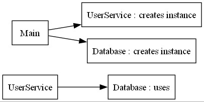

**🤖 Agentic AI – Use Cases**

A curated collection of three fully working mini Agentic AI projects, each demonstrating autonomous reasoning, tool use, and API interaction using Azure OpenAI.
These agents showcase different problem-solving capabilities such as code analysis, diagram generation, and automated test creation.

**📦 Included Use-Cases:**

**1️⃣ Bug Finder Agent** -
A Python code auditing AI that detects bugs, vulnerabilities, bad practices, and provides corrected code.
Demonstrates: static analysis, code reasoning, markdown reporting.

**2️⃣ CodeSketch Agent** -
Converts Python code into Mermaid diagrams and JPG architecture diagrams using Azure OpenAI + Graphviz.
Demonstrates: code structure extraction, diagram generation, tool-assisted rendering.

**3️⃣ Test Case Generator Agent** -
Reads Python files and produces an entire test plan + pytest test file automatically.
Demonstrates: function analysis, structured JSON outputs, QA automation.
