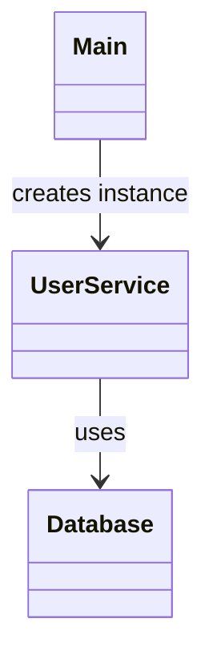

# CodeSketch AI Agent

An autonomous architecture visualization agent that extracts class hierarchies, dependencies, and execution flows from Python source code, synthesizes Mermaid definitions, and renders production-ready architecture diagrams via Graphviz.

---

## Capabilities

- **Code Structure Parsing:** Ingests Python modules and analyzes relationships, class contracts, and function calls.
- **Mermaid Diagram Synthesis:** Prompts Azure OpenAI to construct strict Mermaid class and sequence definitions.
- **Automated Image Rendering:** Converts Mermaid definitions into raster JPG diagrams using Graphviz.
- **Zero-Manual Execution:** Fully autonomous pipeline from code ingestion to persisted image artifacts.

---

## Project Structure

```text
codesketch-agent/
├── agent_llm.py            # Azure OpenAI client wrapper
├── code_parser.py          # AST and code structure reader
├── diagram_generator.py    # Prompt builder and Mermaid synthesizer
├── utils.py                # Graphviz converter and persistence helpers
├── main.py                 # Agent CLI entrypoint
├── sample_code.py          # Reference input code
├── requirements.txt        # Dependencies
└── README.md               # Documentation
```

---

## Pipeline Workflow

```text
Python Source Code ──► LLM Structural Reasoning ──► Mermaid Markup ──► Graphviz Rendering ──► JPG Image
```

1. **Code Extraction:** `code_parser.py` loads and prepares the source code.
2. **LLM Synthesis:** `diagram_generator.py` instructs Azure OpenAI to build structural diagrams representing classes, interfaces, and associations.
3. **Rendering & Export:** `utils.py` interfaces with Graphviz to produce both `diagram.md` (raw Mermaid) and `diagram.jpg` (rendered image).

---

## Output Example


Generated Mermaid definition:


---

## Installation & Setup

### 1. Virtual Environment
```bash
python -m venv .venv
source .venv/bin/activate  # macOS/Linux
.venv\Scripts\activate     # Windows
```

### 2. Dependencies
```bash
pip install -r requirements.txt
```

### 3. Graphviz System Tool
Graphviz is required for raster JPG rendering:
- **Windows:** Download from [graphviz.org](https://graphviz.org/download/) and add `C:\Program Files\Graphviz\bin` to PATH.
- **macOS:** `brew install graphviz`
- **Linux:** `sudo apt install graphviz`

### 4. Environment Variables
Create a `.env` file in this directory:

```env
AZURE_OPENAI_ENDPOINT=https://your-resource.openai.azure.com/
AZURE_OPENAI_API_KEY=your_key
AZURE_OPENAI_API_VERSION=2024-12-01-preview
AZURE_OPENAI_DEPLOYMENT=your_model_name
```

---

## Usage

Run the agent against a Python file:

```bash
python main.py sample_code.py
```

Console output:
```text
===== GENERATED DIAGRAM =====
classDiagram
    Main --> UserService : creates instance
    UserService --> Database : uses
=============================
Diagram saved to diagram.md
JPG saved to diagram.jpg
```
