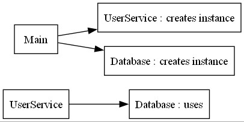

# 🧠 CodeSketch AI Agent

Convert any Python code into **automatic architecture diagrams** using **Azure OpenAI + Mermaid + Graphviz (JPG output)**.

This agent reads Python code, understands its classes/functions, and generates:

* ✔️ Mermaid architecture diagram (`diagram.md`)
* ✔️ Auto-rendered JPG diagram using Graphviz (`diagram.jpg`)

Perfect for:
* Understanding internal code flow
* Quick architecture documentation
* Demonstrating agentic AI with tool-use

---

## 🚀 Features

### ✅ Core Agent Capabilities

* Reads Python code
* Extracts structure, classes, methods, relationships
* Generates clean Mermaid diagrams
* Converts Mermaid → JPG automatically
* Fully autonomous pipeline

### ✅ Demonstrates Agentic AI Principles

* **Agent Structure:** LLM + Planning + Tools
* **Tool Use:** Local filesystem, Graphviz
* **Task Breakdown:** Code → Diagram Prompt → Mermaid → JPG → Save
* **Autonomy:** No manual steps required

---

## 📁 Project Structure

```
mermaid_diagram_generator/
│
├── agent_llm.py            # Azure OpenAI wrapper
├── code_parser.py          # Code reader
├── diagram_generator.py    # Prompt + Mermaid builder
├── utils.py                # Save helpers + Graphviz converter
├── main.py                 # Main agent runner
├── sample_code.py          # Sample input code
├── requirements.txt
└── README.md
```

---

## 🔧 Installation & Setup

### 1️⃣ Create and activate a virtual environment

```bash
python -m venv .venv
source .venv/bin/activate   # Mac/Linux
.venv\Scripts\activate      # Windows
```

### 2️⃣ Install dependencies

```bash
pip install -r requirements.txt
```

### 3️⃣ Install Graphviz (required for JPG output)

#### Windows:

Download from [https://graphviz.org/download/](https://graphviz.org/download/)
Add to PATH:

```
C:\Program Files\Graphviz\bin
```

#### Mac:

```bash
brew install graphviz
```

#### Linux:

```bash
sudo apt install graphviz
```

### 4️⃣ Create your `.env`

```
AZURE_OPENAI_ENDPOINT=https://YOUR-ENDPOINT.openai.azure.com/
AZURE_OPENAI_API_KEY=YOUR-KEY
AZURE_OPENAI_API_VERSION=2024-12-01-preview
AZURE_OPENAI_DEPLOYMENT=YOUR-DEPLOYMENT-NAME
```

---

## ▶️ Run the Agent

```bash
python main.py sample_code.py
```

You will get:

* `diagram.md` → Mermaid diagram
* `diagram.jpg` → Rendered diagram

Example output:

```
===== GENERATED DIAGRAM =====
classDiagram
    Main --> UserService : creates instance
    UserService --> Database : uses
=============================
Diagram saved to diagram.md
JPG saved to diagram.jpg
```



---

## 🛠️ How It Works Internally

### 1. **Code Loading**

`code_parser.py` reads your `.py` file.

### 2. **LLM Processing**

`agent_llm.py` sends your code + prompt to Azure OpenAI.

### 3. **Mermaid Generation**

`diagram_generator.py` builds a clean class/flow/sequence diagram.

### 4. **JPG Conversion**

`utils.py` converts Mermaid → SVG → JPG using Graphviz.

Workflow:

```
Python Code → LLM → Mermaid → Graphviz → JPG
```
---

### ✔️ Clear Agent Structure

* LLM ➝ Prompt ➝ Diagram generation ➝ Rendering tool

### ✔️ Tool Interaction

* Azure OpenAI API
* Graphviz system tool
* Local filesystem

### ✔️ Autonomous Behavior

The agent completes the entire pipeline with zero manual prompts.

---

## This project demonstrates: 

* Understanding of agentic task decomposition
* Tool usage
* Secure API handling
* LLM-based reasoning applied to real code
* Output generation (MD + JPG)
